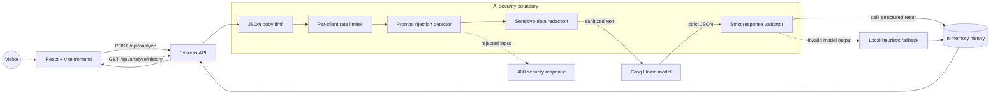

# CySec AI

CySec AI is a full-stack cybersecurity awareness app that helps people understand suspicious messages before they click, reply, or share sensitive information.

The app combines a focused, professional dark interface with AI-assisted threat analysis and short phishing-awareness simulations. It classifies messages as **Safe**, **Phishing**, **Malware**, or **Social Engineering**, explains the signals it found, and provides practical next steps.

## Live demo

- Frontend: [ai-cybersecurity-app.vercel.app](https://ai-cybersecurity-app.vercel.app)
- API: [ai-cybersecurity-app.onrender.com](https://ai-cybersecurity-app.onrender.com)

## What visitors can do

- Analyze a suspicious email, message, or notification.
- See a clear threat category, severity, explanation, and recommendations.
- Review recent analyses in a lightweight history dashboard.
- Practice with simulated phishing scenarios and earn awareness points.
- Export the history dashboard as a PDF report.

## System architecture



### Request flow

1. The browser sends text to the Express API.
2. The API enforces a request-size limit and per-client rate limit.
3. Prompt-injection patterns are rejected before any model call.
4. Sensitive values are redacted before the text leaves the backend or enters history.
5. Groq receives the sanitized text inside an explicitly untrusted-data boundary.
6. The model response is accepted only when it matches the allow-listed JSON contract.
7. If the provider is unavailable or returns invalid data, a local heuristic classifier returns a safe structured fallback.

## Security controls

- Prompt-injection detection rejects common instruction-override, privileged-prompt probing, role-escalation, safety-bypass, and instruction-payload patterns.
- Sensitive-data redaction covers email addresses, payment-card numbers, SSNs, JWTs, common API keys, bearer tokens, secret assignments, phone numbers, and IPv4 addresses.
- AI responses are validated against fixed threat types, severities, field names, string lengths, and recommendation counts.
- Analysis and history routes use an in-memory per-client rate limiter.
- JSON request bodies are capped at 16 KB by default.
- The frontend uses a restrained navy, slate, and blue visual system with separate amber, red, and green status colors for clear risk communication.

## Tech stack

### Frontend

- React 19
- Vite
- Axios
- Recharts
- Lucide React
- jsPDF and html2canvas

### Backend

- Node.js
- Express 5
- Groq SDK
- Helmet
- Morgan
- CORS
- Node's built-in test runner

## Run locally

### 1. Clone and install

```bash
git clone https://github.com/Alizaki22/ai-cybersecurity-app.git
cd ai-cybersecurity-app

cd backend
npm install

cd ../frontend
npm install
```

### 2. Configure the backend

Create `backend/.env`:

```env
GROQ_API_KEY=your_api_key_here
PORT=5000
JSON_BODY_LIMIT=16kb
ANALYZE_RATE_LIMIT=30
ANALYZE_RATE_WINDOW_MS=60000
```

The app still works without a Groq key by using the local heuristic fallback, which is useful for development and UI previews.

### 3. Start both services

In `backend`:

```bash
npm run dev
```

In `frontend`:

```bash
npm run dev
```

The frontend expects the API at `http://localhost:5000`. Update the Axios base URL in `frontend/src/App.jsx` if your backend runs elsewhere.

## API reference

### `POST /api/analyze`

Request:

```json
{
  "text": "Your account needs an urgent password reset."
}
```

Response:

```json
{
  "type": "Phishing",
  "severity": "High",
  "explanation": "The message requests sensitive account action.",
  "recommendations": [
    "Do not click unknown links.",
    "Verify the request through an independent channel."
  ]
}
```

### `GET /api/analyze/history`

Returns the most recent 50 sanitized analyses held in memory. History resets when the backend restarts.

## Project structure

```text
backend/
  src/
    controllers/       Analysis and history handlers
    routes/            Express API routes
    security/          Injection, redaction, validation, and rate limiting
    server.js          Express server entry point
  test/                Security regression tests
frontend/
  src/App.jsx          Main application UI and theme
  src/index.css        Global entry styles
```

## Scripts

| Directory | Command | Purpose |
| --- | --- | --- |
| `backend` | `npm start` | Start the API |
| `backend` | `npm run dev` | Start the API with Nodemon |
| `backend` | `npm test` | Run security regression tests |
| `frontend` | `npm run dev` | Start the Vite development server |
| `frontend` | `npm run build` | Create a production build |
| `frontend` | `npm run lint` | Run ESLint |

## Current limitations

- History is intentionally in memory and is not a durable database.
- The local fallback is a lightweight heuristic and is not a replacement for a full security investigation.
- Authentication and per-user history are not implemented yet.
- URL reputation scanning and attachment analysis are outside the current scope.

## Contributing

1. Create a branch from `main`.
2. Keep secrets out of source control.
3. Add or update tests for behavior changes.
4. Run the relevant backend and frontend checks before opening a pull request.

## License

This project is open source and available under the MIT License.

## Author

**Aliyu Gambo Abubakar**
